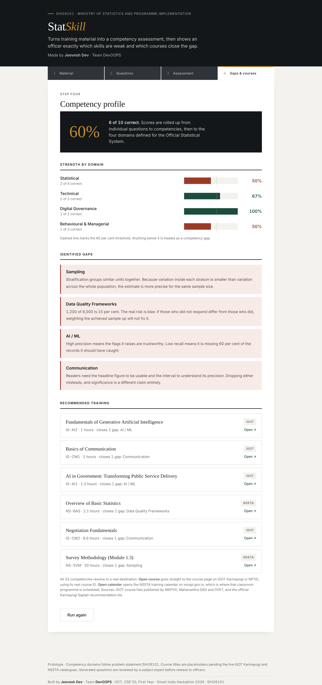
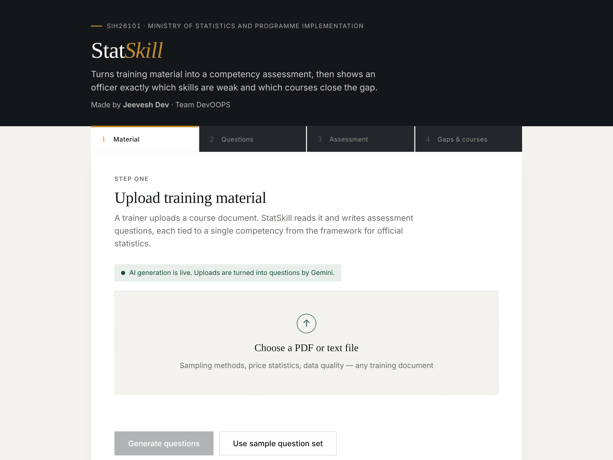
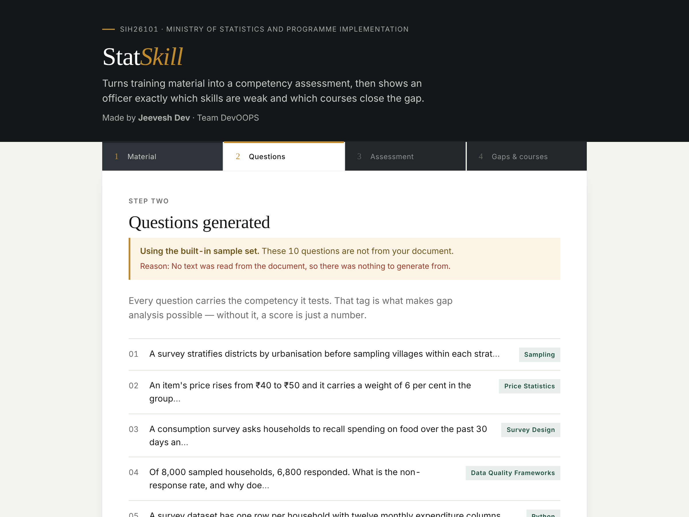
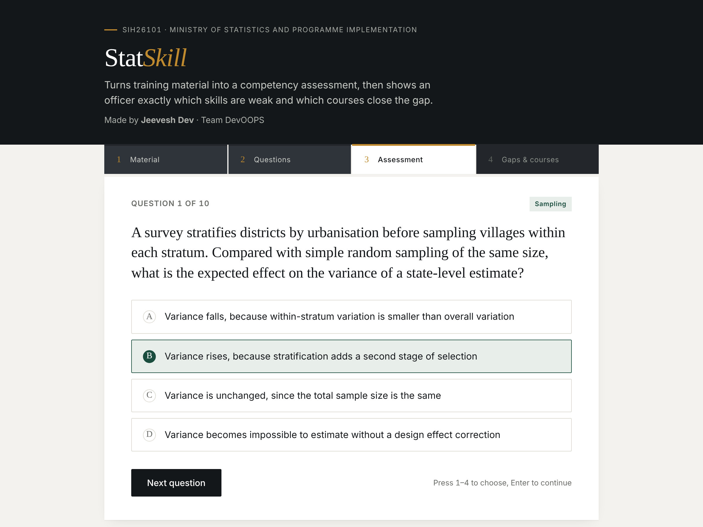
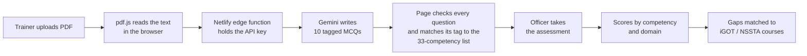
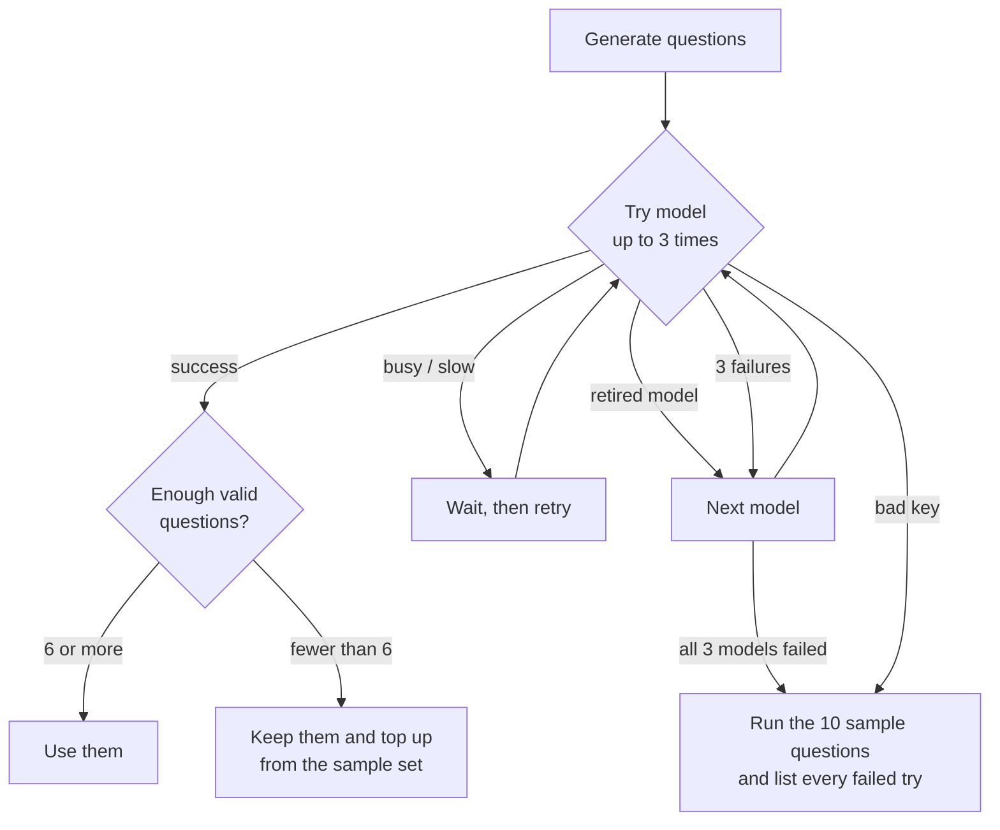
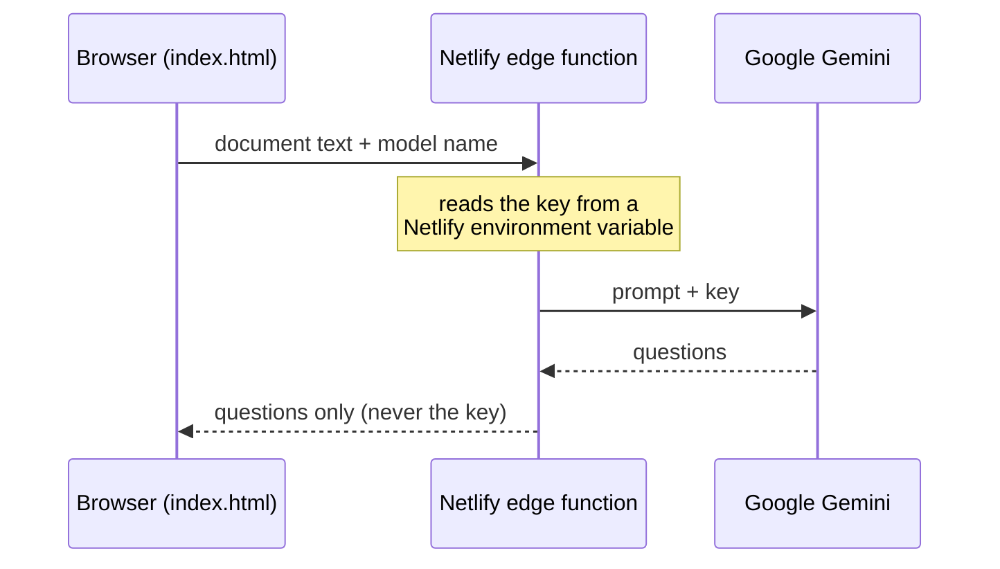

<div align="center">

# StatSkill

**Turns any training PDF into a competency test for statistics officers, then shows exactly which skills are weak and which iGOT Karmayogi or NSSTA courses close each gap.**

[](https://benevolent-nasturtium-637b58.netlify.app)
[](https://sih.gov.in)
[](https://github.com/JeeveshDev17/statskill/actions/workflows/check.yml)
[](LICENSE)

Smart India Hackathon 2026 · Problem Statement **SIH26101** · Ministry of Statistics and Programme Implementation (MoSPI)

Made by **Jeevesh Dev** · Team **DevOOPS** · OCT, CSE'30, First Year

**[Open the live app](https://benevolent-nasturtium-637b58.netlify.app)** · [GitHub Pages copy](https://jeeveshdev17.github.io/statskill/) · [Try it with the sample PDF](examples/sample-training-material.pdf)



</div>

---

## Contents

- [The problem](#the-problem)
- [What StatSkill does](#what-statskill-does)
- [Screenshots](#screenshots)
- [How it works](#how-it-works)
- [Features](#features)
- [How the API key is kept secret](#how-the-api-key-is-kept-secret)
- [Tech stack](#tech-stack)
- [Project structure](#project-structure)
- [Run it yourself](#run-it-yourself)
- [Tests](#tests)
- [Limitations](#limitations)
- [Roadmap](#roadmap)
- [Team and credits](#team-and-credits)
- [License](#license)

---

## The problem

Officers in India's Official Statistical System need skills across four very different areas: statistical methods, technical tools, digital governance, and management. Training material exists in large volumes, but there is no quick way to:

1. turn a new training document into a fair test,
2. find out **which specific skills** an officer is weak in, rather than just a single score, and
3. point that officer to the **right course** for each weak skill.

Problem statement **SIH26101** asks for an AI-assisted way to do this, built around a framework of 33 named competencies.

## What StatSkill does

1. **Upload.** A trainer uploads a training document (a text-based PDF, `.txt` or `.md`).
2. **Generate.** Gemini writes 10 multiple-choice questions from that document. Each one is tagged to **one** of the 33 competencies in the problem statement.
3. **Assess.** An officer answers the questions.
4. **Analyse.** Scores roll up from questions to competencies to the four domains. Any domain below **60%** is flagged, and each wrong answer's competency becomes a named gap with an explanation.
5. **Recommend.** Each gap is matched to an iGOT Karmayogi course or NSSTA programme, with a direct link.

Questions can also be exported as **QuML**, the question format used by Sunbird, the platform iGOT Karmayogi runs on.

## Screenshots

| Upload training material | Questions tagged by competency |
|---|---|
|  |  |

| Taking the assessment | Competency profile and courses |
|---|---|
|  |  |

> These screenshots use the built-in sample question set, so the questions screen shows the sample-set banner. With a live upload, the banner instead says how many questions Gemini wrote from your document.

## How it works



### What happens when something goes wrong

The app is built so it **never shows a blank screen**. Every failure leads somewhere usable, and the reason is shown on screen rather than hidden.



Models are tried in this order: `gemini-3.8-flash`, then `gemini-3.6-flash`, then `gemini-flash-lite-latest`. The page shows progress while it works, for example *"Writing questions with gemini-3.8-flash · try 2 of 3…"*.

## Features

- **33-competency framework.** Every question maps to one competency from SIH26101, across four domains: Statistical, Technical, Digital Governance, and Behavioural & Managerial. See [docs/competency-framework.md](docs/competency-framework.md).
- **Quality checks on AI output.** A question is kept only if it has real text, exactly 4 different options and one valid answer. Each tag is matched to the official list by competency ID or name (ignoring case and punctuation), and questions with unknown tags are dropped.
- **Salvages cut-off replies.** If Gemini's reply is cut off midway, the complete questions are still recovered from it.
- **Course recommendations.** 35 courses: 20 iGOT Karmayogi courses with their real course IDs, 13 NSSTA programmes, and 2 general iGOT links.
- **QuML export.** Download the questions in the format Sunbird's assessment engine reads. Example: [examples/sample-quml-export.json](examples/sample-quml-export.json).
- **Honest fallback.** When the AI is unavailable, a reviewed set of 10 sample questions runs, and the banner says so.
- **No accounts, no database.** Everything happens in the browser except the single call to Gemini.
- **Accessible.** Keyboard navigation and visible focus throughout.

## How the API key is kept secret



- There is **no API key anywhere in this repository**, and an automated test fails the build if one is ever added.
- The key lives only in Netlify's environment variables, under the name `MCQ_Generator` (`STATSKILL_GEMINI_KEY` also works).
- The edge function builds its own question-writing prompt and only accepts its 3 approved models, so other people can't use it as a free general-purpose Gemini proxy.
- Only approved websites can call it: Netlify sites, GitHub Pages sites and local testing. This can be locked down further with an `ALLOWED_ORIGINS` variable.

See [SECURITY.md](SECURITY.md) for details.

## Tech stack

| Part | Technology | Why |
|---|---|---|
| Front end | Plain HTML, CSS and JavaScript in one file | Nothing to build or install. Opens anywhere. |
| PDF reading | [pdf.js](https://mozilla.github.io/pdf.js/) 3.11.174 | Reads PDF text in the browser, so documents never need to be stored. |
| Server | Netlify Edge Functions | Keeps the API key off the page. Free tier. |
| AI | Google Gemini (Flash models) | Fast, low-cost question generation with JSON output. |
| Output format | QuML | Matches the Sunbird platform behind iGOT Karmayogi. |
| Hosting | Netlify (live AI) and GitHub Pages | Two public links, both using the same generator. |
| Checks | Node's built-in test runner, GitHub Actions, gitleaks | Tests and a secret scan run on every push. |

## Project structure

```
statskill/
├── index.html                      The whole app: page, design and logic
├── netlify/
│   └── edge-functions/
│       └── generate.js             Server function: holds the key, calls Gemini
├── netlify.toml                    Netlify settings (no build step)
├── tests/
│   ├── generate.test.mjs           22 tests for the server function
│   └── check-repo.mjs              Page parses, no keys committed, model lists match
├── examples/
│   ├── sample-training-material.pdf   A PDF to try the app with
│   └── sample-quml-export.json        What a QuML export looks like
├── docs/
│   ├── competency-framework.md     The 33 competencies
│   ├── screenshots/                Images used in this README
│   └── social-preview.png          Image shown when the repo link is shared
├── .github/                        Automatic checks, issue and PR templates
├── package.json                    Test command (no dependencies)
├── SECURITY.md · CHANGELOG.md · CONTRIBUTING.md · LICENSE
└── .gitignore · .gitattributes
```

## Run it yourself

### Just use it

Open the [live app](https://benevolent-nasturtium-637b58.netlify.app), upload a text-based PDF (or the [sample PDF](examples/sample-training-material.pdf)) and click **Generate questions**.

### Open it on your own computer

Download `index.html` and open it in a browser. It calls the Netlify generator set in `NETLIFY_SITE` near the top of the script, so live AI still works.

### Deploy your own copy

1. **Get a Gemini API key** at [aistudio.google.com/apikey](https://aistudio.google.com/apikey). It usually starts with `AQ.` or `AIza`.
2. **Fork this repository** on GitHub.
3. **Import it into Netlify:** Add new project → Import an existing project → GitHub → choose the repo. Leave the build command empty and the publish directory as `.`.
4. **Add the key:** Project configuration → Environment variables → Add a variable.
   - Key: `MCQ_Generator`
   - Value: your API key
   - Scopes: All scopes · Same value for all deploy contexts

   > ⚠️ **Do not name it `GEMINI_API_KEY`.** Netlify's AI Gateway fills that name with its own token, and Google rejects it as "API key not valid".
5. **Deploy:** Deploys → Trigger deploy → Deploy site.
6. **Check it:** open `https://<your-site>.netlify.app/api/generate`. You should see `"key":true` and the first 4 characters of your key.
7. **Point the page at your site:** change `NETLIFY_SITE` in `index.html` to your Netlify address.
8. **Optional:** on GitHub, Settings → Pages → Deploy from a branch → `main` / root.

## Tests

```bash
npm test
```

Needs Node 18 or newer. There is nothing to install. The 25 tests use a fake Google server, so they're free, fast, and need no API key. They cover:

- the health check never reveals the full key,
- the key is read from the right variable and cleaned of pasted spaces and quotes,
- `AQ.` keys are sent the way Google accepts them, with a retry in a header,
- busy, retired and unknown models are handled correctly,
- the prompt includes the document and the full competency list,
- unknown websites are blocked,
- the page's script parses, no API key is in any file, and the page and server use the same model list.

GitHub Actions runs these on every push, together with a [gitleaks](https://github.com/gitleaks/gitleaks) scan of the whole history.

## Limitations

- **Scanned PDFs don't work.** A scanned page is an image with no text layer, so there is nothing to read. OCR is on the roadmap.
- **Only the first 6,000 characters are used**, to keep Gemini fast enough for Netlify's time limit.
- **Google's free tier is sometimes busy.** The app retries 3 models up to 3 times each, then falls back to the sample questions.
- **Questions should be reviewed** by a subject expert before they are used for real assessments.
- **Results are not saved.** Refreshing the page starts over.
- **Some course links are general.** NSSTA programmes link to the NSSTA site rather than a specific course page, because NSSTA doesn't publish per-course URLs.

## Roadmap

- [ ] Officer sign-in, with results saved over time to show progress
- [ ] OCR for scanned PDFs
- [ ] Questions in Hindi and other Indian languages
- [ ] Adaptive difficulty: harder questions after correct answers
- [ ] Trainer review screen to edit or approve questions before release
- [ ] Direct publishing of QuML question sets to iGOT Karmayogi
- [ ] Team dashboard showing common gaps across a whole batch of officers

## Team and credits

**Jeevesh Dev**, Team DevOOPS · OCT, CSE'30, First Year

Built for Smart India Hackathon 2026, problem statement SIH26101, set by the Ministry of Statistics and Programme Implementation.

Thanks to:
- [pdf.js](https://github.com/mozilla/pdf.js) by Mozilla, for reading PDFs in the browser
- [iGOT Karmayogi](https://igotkarmayogi.gov.in) and the [National Statistical Systems Training Academy (NSSTA)](https://nssta.gov.in), whose course catalogues the recommendations link to
- Google Gemini, for question generation
- Netlify, for hosting and edge functions

## License

[MIT](LICENSE) © 2026 Jeevesh Dev
